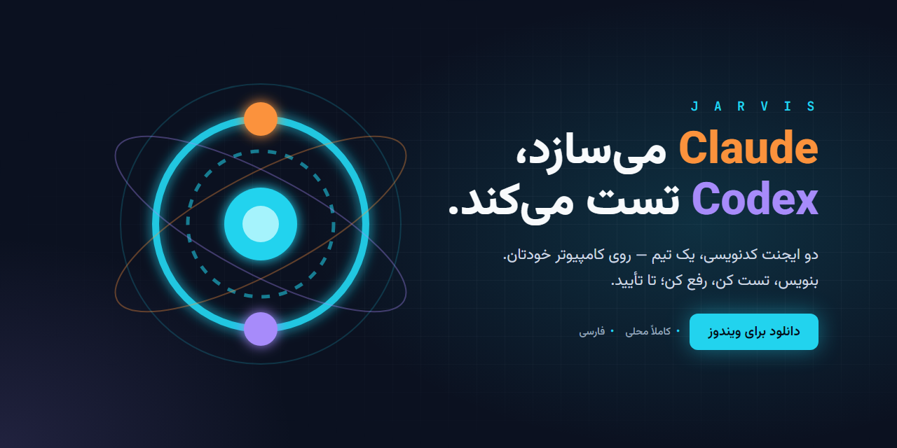

# JARVIS — Claude می‌سازد، Codex تست می‌کند

یک برنامه‌ی ویندوزی (و پنل وب) کاملاً محلی که دو ایجنت کدنویسی را مثل یک تیم کنار هم می‌گذارد:

| ایجنت | نقش |
|---|---|
| **Claude** | سازنده — همه‌ی کد را می‌نویسد و باگ‌ها را رفع می‌کند |
| **Codex** | تحلیلگر و تستر — تغییرات را بررسی می‌کند، build/تست اجرا می‌کند و باگ‌ها را به‌صورت ساختاریافته (JSON) گزارش می‌دهد |

## برنامه‌ی ویندوز

نصب: فایل `dist/JARVIS-Setup-<نسخه>.exe` را اجرا کنید. بار اول پنجره‌ی **«اتصال حساب‌ها»** باز می‌شود:
- **Claude:** کلید API از [Anthropic Console](https://console.anthropic.com/settings/keys). (طبق سیاست Anthropic، برنامه‌های شخص ثالث بدون تأیید Anthropic نمی‌توانند ورود با اشتراک Pro/Max ارائه دهند؛ این نسخه با پرچم `jarvis.allowClaudeAiLogin` در `package.json` خاموش است.)
- **Codex:** ورود با حساب ChatGPT یا کلید API OpenAI.
- اگر CLIها نصب نباشند، نصب‌کننده‌ی رسمی هرکدام از همین پنجره اجرا می‌شود.

همه‌چیز محلی است: سرور فقط روی `127.0.0.1`، داده‌ها در `%APPDATA%\JARVIS`، کلیدها با DPAPI ویندوز رمزنگاری می‌شوند و فقط به خود CLI داده می‌شوند. برنامه هیچ داده‌ای جایی نمی‌فرستد (به‌جز تماس خود CLIها با مدل‌ها).

ساخت نصب‌کننده:
```bash
npm install
npm run dist
```
خروجی: `dist/JARVIS-Setup-<نسخه>.exe`. فایل امضای دیجیتال ندارد؛ برای انتشار عمومی یک گواهی code-signing بگیرید تا SmartScreen هشدار ندهد.

## به‌روزرسانی خودکار

نسخه‌ی نصب‌شده هر چند ساعت یک بار GitHub Releases همین مخزن را بررسی می‌کند. اگر نسخه‌ی تازه‌ای باشد، آن را در پس‌زمینه دانلود می‌کند و نوار «نصب و راه‌اندازی دوباره» را نشان می‌دهد. اگر نصب را نزنید، با بستن کامل برنامه خودکار نصب می‌شود. این کار را می‌توانید در «تنظیمات ← اپ دسکتاپ» خاموش کنید، یا از «عیب‌یابی» دستی بررسی کنید.

### انتشار نسخه‌ی جدید

```bash
npm run release
```
این دستور شماره‌ی نسخه را یکی بالا می‌برد، تگ `vX.Y.Z` می‌سازد و push می‌کند. بعد GitHub Actions (`.github/workflows/release.yml`) تست‌ها را اجرا می‌کند، نصب‌کننده را می‌سازد و در Releases منتشر می‌کند. همه‌ی نسخه‌های نصب‌شده از آنجا به‌روز می‌شوند.

### ورود با اشتراک Claude (فقط استفاده‌ی شخصی)

نسخه‌ی منتشرشده در Releases طبق سیاست Anthropic فقط با کلید API به Claude وصل می‌شود. روی کامپیوتر شخصی خودتان، اگر می‌خواهید جارویس از ورود Claude Code با اشتراک Pro/Max خودتان استفاده کند، یک بار این دستور را اجرا کنید و جارویس را دوباره باز کنید (بعد از به‌روزرسانی‌ها هم باقی می‌ماند):

```bash
setx JARVIS_ALLOW_CLAUDE_LOGIN 1
```

## اجرا بدون نصب (برای توسعه)

```bash
node server.js
```
یا روی `start.bat` دوبار کلیک کنید. سپس `http://localhost:4777` را باز کنید. برای پنجره‌ی دسکتاپ: `npm run app`.
نیازمندی‌ها: Node 18+، و CLI های `claude` و `codex` که لاگین شده باشند.

## طراحی

دیزاین‌سیستم سه‌لایه (primitive → semantic → component) با تم تیره و روشن، آیکون‌های Lucide و فونت‌های داخلی؛ جزئیات در [design/DESIGN.md](design/DESIGN.md).

## حالت‌های چت

- **🤝 تیمی**: Claude می‌نویسد ← Codex تست می‌کند ← اگر باگ بود Claude رفع می‌کند ← دوباره تست… تا تأیید یا رسیدن به سقف دورها.
- **🔎 بازرسی و رفع**: Codex اول پروژه‌ی موجود را تحلیل و تست می‌کند، Claude باگ‌ها را رفع می‌کند، Codex دوباره تأیید می‌کند.
- **🧭 طراحی**: Claude طرح می‌دهد، Codex نقد می‌کند، Claude طرح نهایی را می‌نویسد (بدون تغییر کد).
- **Claude** / **Codex**: گفتگوی مستقیم با یک ایجنت.

**پیام حین اجرا:** وقتی تیم در حال کار است هم می‌توانید بنویسید (دکمه‌ی زرد «➕ به صف»). پیام‌ها در صف می‌مانند و در مرحله‌ی بعدیِ Claude (نوشتن کد یا رفع باگ) به او تحویل داده می‌شوند؛ اگر بعد از آخرین مرحله رسیده باشند، یک دور تکمیلی با همان حالت اجرا می‌شود. با «توقف»، پیام‌های تحویل‌نشده در چت اعلام می‌شوند.

هر چت، نشست Claude و thread مربوط به Codex را نگه می‌دارد، پس هر دو ایجنت حافظه‌ی گفتگو را دارند («↺ نشست تازه» آن را پاک می‌کند).

## ساب‌ایجنت‌ها (متخصص‌ها)

در نوار کناری بخش «ساب‌ایجنت‌ها» را می‌بینید. هر ساب‌ایجنت یکی از دو نقش را دارد:

- **تستر موازی** (stage = review): در هر دور بررسی، هم‌زمان با تستر اصلی اجرا می‌شود (با Claude یا Codex) و باگ‌هایش به لیست رفع اضافه می‌شود. باگ critical/major یک متخصص هم کار را رد می‌کند؛ ولی متخصص‌ها به‌تنهایی نمی‌توانند کار را تأیید کنند.
- **کمکِ سازنده** (stage = builder): از طریق `--agents` به Claude Code داده می‌شود تا هنگام نوشتن کد کار را به او بسپارد (مثلاً نوشتن تست). کارهای او در چت با تورفتگی و برچسب «↳ ساب‌ایجنت» نمایش داده می‌شود.

پیش‌فرض‌ها: 🛡 `security`، ⚡ `perf`، 🎨 `ux`، 🧪 `test-writer`، 📝 `docs-writer` — با تیک فعال/غیرفعال کنید، با کلیک ویرایش کنید، یا با «+ ساب‌ایجنت» متخصص خودتان را بسازید.
در هر چت با `@name ...` مستقیم با یک ساب‌ایجنت حرف بزنید (دکمه‌های بالای کادر پیام).

### 🧩 اسکیل‌های ساب‌ایجنت

در پنجره‌ی هر ساب‌ایجنت بخش «اسکیل‌ها» هست:
- **+ اسکیل جدید:** نام، توضیح (ایجنت از روی آن تصمیم می‌گیرد کی استفاده کند) و دستورالعمل Markdown — با همان قالب `SKILL.md` خود Claude Code.
- **📥 از اسکیل‌های نصب‌شده:** اسکیل‌های `~/.claude/skills`، `~/.codex/skills`، `~/.agents/skills` و `.claude/skills` پروژه‌ها را پیدا می‌کند؛ یا مسیر هر پوشه‌ای که `SKILL.md` دارد. یک کپی در `data/skills/` ساخته می‌شود.
- هر اسکیل در یک کتابخانه است و می‌شود به چند ساب‌ایجنت وصلش کرد.

**صرفه‌جویی در توکن:** اسکیل‌های کوچک (زیر ~۲۵۰۰ کاراکتر) کامل در دستورالعمل ساب‌ایجنت قرار می‌گیرند؛ اسکیل‌های بزرگ فقط با نام و توضیح، و ساب‌ایجنت فقط وقتی کار به آن مربوط بود فایلش را می‌خواند (دسترسی خواندن با `--add-dir`). هم برای Claude و هم Codex، و هم برای تسترهای موازی و هم کمک‌های سازنده کار می‌کند.

## 🕸 گراف کد با graphify (کمتر توکن)

جارویس از [graphify](https://github.com/Graphify-Labs/graphify) استفاده می‌کند تا Claude و Codex به‌جای جستجو و خواندن کل فایل‌ها، از یک **گراف دانش کد** بپرسند که هر چیز کجاست (فایل + خط) و به چه وصل است:

- قبل از هر اجرا (و هر دور بررسی) گراف پروژه با `graphify update` به‌روز می‌شود — **کاملاً محلی، بدون LLM و بدون کلید API** (tree-sitter).
- به همه‌ی ایجنت‌ها دستور داده می‌شود اول `graphify query / explain / path / affected` را اجرا کنند و فقط فایل‌هایی را بخوانند که گراف نشان می‌دهد. این دستورها در فهرست مجاز Claude هستند.
- `graphify-out/` داخل پروژه ساخته می‌شود ولی به `.git/info/exclude` اضافه می‌شود تا در git status دیده نشود (فایل‌های پروژه دست نمی‌خورند).
- نصب: `uv tool install graphifyy` — در تنظیمات (⚡) می‌توانید خاموش/روشنش کنید.

**نتیجه‌ی اندازه‌گیری واقعی (صادقانه):** روی دو پروژه (کد خود جارویس، ~۱۲ فایل؛ و Flask، ~۲۴۰ فایل) با یک سؤال ثابت:

| | بدون گراف | با گراف |
|---|---|---|
| Claude روی جارویس | $0.081 | $0.072 (−۱۲٪) |
| Claude روی Flask | $0.073 و $0.061 (دو اجرا) | $0.084 — از گراف استفاده نکرد |
| Claude روی Flask + پیش‌پرسش | — | $0.088 — فایل‌های بیشتری خواند |
| Codex روی جارویس | ۱۸۶K توکن | ۱۵۹K (−۱۴٪)، ولی Codex شما حتی بدون جارویس هم graphify را دارد |

یعنی **روی این تست‌ها صرفه‌جویی قابل اتکایی دیده نشد**؛ Claude پروژه‌های معروف را مستقیم با Grep پیدا می‌کند و اختلاف دو اجرای یکسان هم ~۱۷٪ است. ادعای «۶٫۴ برابر» خود graphify در مقایسه با خواندن *کل* پروژه است که ایجنت‌ها معمولاً نمی‌کنند. احتمالاً روی پروژه‌های خیلی بزرگ و ناآشنا مفیدتر است؛ داشبورد مصرف را برای مقایسه‌ی پروژه‌ی خودتان ببینید. «پیش‌پرسش» (graphifyPreQuery) به همین دلیل پیش‌فرض خاموش است.

## 📊 داشبورد مصرف (صفحه‌ی اصلی)

با کلیک روی لوگو به صفحه‌ی اصلی برمی‌گردید. آنجا:
- نمودار سه‌بعدی **مصرف روزانه به تفکیک مدل** (ستون‌ها: روز × مدل) — بکشید تا بچرخد، روی ستون‌ها بروید تا عدد دقیق را ببینید.
- دونات سه‌بعدی **سهم هر مدل** + جدول دقیق.
- **گراف سه‌بعدی کد پروژه** از graphify (گره‌ها = توابع/کلاس‌ها/فایل‌ها، رنگ = گروه).
- فیلتر بازه (۷/۱۴/۳۰ روز)، توکن یا هزینه، همه‌ی پروژه‌ها یا فقط پروژه‌ی فعلی.

مصرف هر مرحله (مدل، توکن ورودی/خروجی/کش، هزینه) در `data/usage.jsonl` روی همین کامپیوتر ثبت می‌شود. three.js و فونت داخل برنامه هستند؛ صفحه هیچ درخواستی به اینترنت نمی‌فرستد.

## امکانات اضافه

- **گزارش نهایی** هر اجرا: زمان، دورها، هزینه، فایل‌ها، تست‌ها، شاخه و commit.
- **diff همین اجرا به تستر داده می‌شود** (نسبت به نقطه‌ی بازگشت)، نه تغییرات قدیمیِ commitنشده‌ی شما.
- **قفل پروژه:** دو چت هم‌زمان روی یک پروژه کار نمی‌کنند؛ دومی منتظر می‌ماند.
- **نگهبان تستر:** اگر تستر فایلی را تغییر دهد، هشدار می‌دهد یا خودکار برمی‌گرداند.
- **نقطه‌ی بازگشت خودکار** قبل از هر اجرا (در پروژه‌های git) — بدون دست زدن به index، branch یا stash شما؛ زیر `refs/jarvis/*` ذخیره می‌شود. هنگام بازگشت می‌توانید فایل‌هایی را که بعد از آن ساخته شده‌اند هم حذف کنید.
- **نمایش تغییرات (diff)** و خلاصه‌ی تغییرات بعد از هر اجرا.
- **جایگزینی خودکار تستر**: اگر Codex به سقف مصرف برسد، Claude در یک نشست *جداگانه* و فقط‌خواندنی (Read/Grep/Glob/Bash) نقش تستر را می‌گیرد.
- **کشف پروژه‌ها** از تاریخچه‌ی Claude Code (`~/.claude.json`) و Codex (`~/.codex/sessions`).
- **همگام‌سازی دستورالعمل‌ها**: CLAUDE.md ⇄ AGENTS.md تا هر دو ایجنت قوانین پروژه را بدانند.
- محاسبه‌ی هزینه‌ی Claude و توکن‌های Codex برای هر چت.
- ورودی صوتی فارسی 🎙، اعلان دسکتاپ، و اعلام صوتی پایان کار.
- دکمه‌ی توقف که کل درخت پروسه‌ها را می‌بندد.

## تنظیمات (⚙ بالا سمت چپ — سراسری، یا «⚙ تنظیمات پروژه» برای یک پروژه)

هر تنظیمی را می‌شود برای یک پروژه‌ی خاص جدا کرد؛ بقیه‌ی پروژه‌ها از تنظیمات سراسری پیروی می‌کنند.

| بخش | تنظیم | پیش‌فرض |
|---|---|---|
| ⚡ سرعت و هزینه | حالت سبک (بدون MCP/اسکیل/هوک کاربر، فقط ابزارهای لازم) | روشن |
| | سقف هزینه‌ی Claude برای هر اجرا | ۵ دلار |
| | ساب‌ایجنت‌های تستر: فقط بعد از تأیید تستر اصلی / هر دور | بعد از تأیید |
| | طول diff که به تستر داده می‌شود | ۴۰٬۰۰۰ کاراکتر |
| | نمایش زنده‌ی متن Claude | روشن |
| 🧠 مدل‌ها | مدل و میزان فکر سازنده | sonnet · medium |
| | مدل و میزان فکر Claude در نقش تستر | sonnet · low |
| | مدل و میزان فکر ساب‌ایجنت‌های تستر | haiku · low |
| | مدل و میزان فکر Codex | پیش‌فرض Codex |
| 🤝 جریان کار | حداکثر دور، تستر اصلی، جایگزینی با Claude، سندباکس Codex، گزارش نهایی | ۳ · Codex · روشن |
| 🛡 ایمنی | مجوز Claude، دستورات مجاز، قفل پروژه، اگر تستر فایل را تغییر داد (هشدار/برگرداندن)، توکن دسترسی | acceptEdits · روشن · هشدار · خاموش |
| 🌿 گیت | شاخه‌ی جدا برای هر چت، commit خودکار بعد از تأیید | خاموش |
| 🔔 اعلان‌ها | اعلان دسکتاپ، اعلام صوتی | روشن · خاموش |

**نتیجه‌ی اندازه‌گیری روی یک کار یکسان** (ساخت calc.js با تست): نسخه‌ی قبلی ۱٫۱۱ دلار، نسخه‌ی فعلی ۰٫۰۸ دلار (حدود ۱۴ برابر ارزان‌تر) در زمان تقریباً یکسان (~۷۵ ثانیه) — با اینکه حالا Codex واقعی و ساب‌ایجنت امنیت هم بررسی می‌کنند.

**توکن دسترسی:** وقتی روشن شود، فقط مرورگری که آن را روشن کرده و لینکی که سرور در ترمینال چاپ می‌کند (`?token=…`) دسترسی دارند. توکن در `data/token` است.

## ساختار

```
server.js            HTTP + SSE + API
lib/agents.js        اجرای headless برای claude و codex و نرمال‌سازی رویدادها
lib/orchestrator.js  جریان‌های تیمی (ساخت ← تست ← رفع)
lib/git.js           نقطه‌ی بازگشت، diff، اطلاعات git
lib/store.js         ذخیره در data/ (JSON)
review-schema.json   شِمای خروجی گزارش Codex
public/              پنل وب
```

متغیرهای محیطی: `JARVIS_PORT`، `JARVIS_DATA`، `JARVIS_CLAUDE_BIN`، `JARVIS_CODEX_BIN`.
