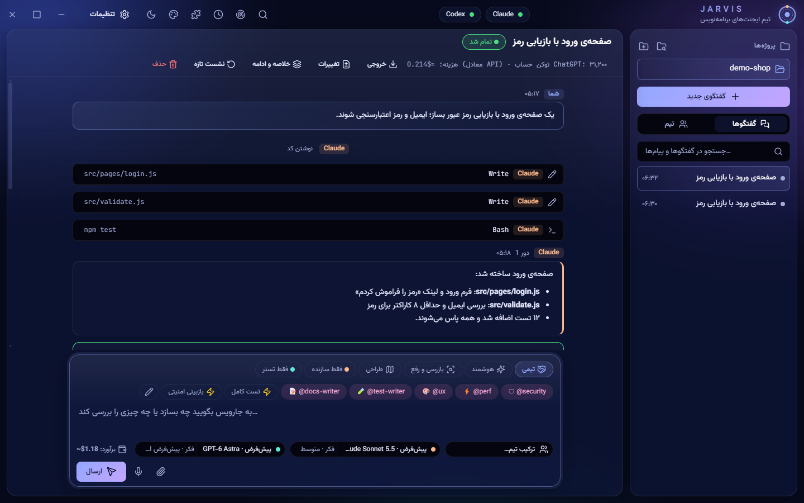
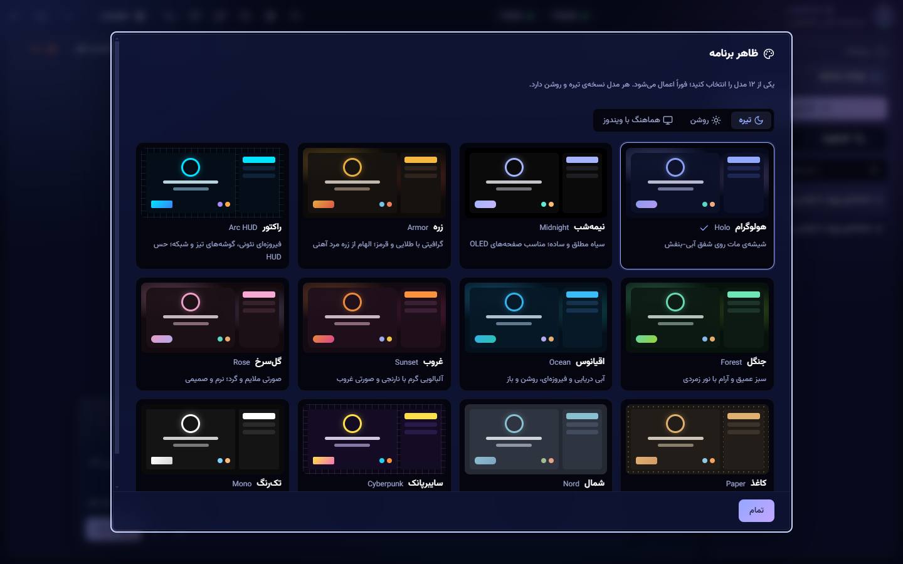

<div dir="rtl">

# جارویس (JARVIS)

**دو هوش مصنوعی برنامه‌نویس، کنار هم، روی کامپیوتر خودتان.**
یکی **سازنده** است و کد را می‌نویسد؛ دیگری **تستر** است و کد را بررسی و تست می‌کند و باگ‌ها را می‌گوید. سازنده باگ‌ها را رفع می‌کند و این رفت‌وبرگشت آن‌قدر ادامه پیدا می‌کند تا تستر کار را تأیید کند. به‌طور پیش‌فرض Claude می‌سازد و Codex تست می‌کند، ولی هر نقش را می‌توانید به DeepSeek یا هر API دیگری بدهید.


<p align="center">
<a href="https://github.com/borhanslm/jarvis-agents/releases/latest/download/JARVIS-Setup.exe"><b>⬇️ دانلود جارویس برای ویندوز</b></a>
&nbsp;·&nbsp;
<a href="https://github.com/borhanslm/jarvis-agents/releases">همه‌ی نسخه‌ها</a>
</p>

---

## فهرست

1. [قبل از نصب چه لازم دارید؟](#قبل-از-نصب-چه-لازم-دارید)
2. [نصب، قدم به قدم](#نصب-قدم-به-قدم)
3. [اولین بار: وصل کردن Claude و Codex](#اولین-بار-وصل-کردن-claude-و-codex)
4. [اولین کار با جارویس](#اولین-کار-با-جارویس)
5. [حالت‌های کار](#حالت‌های-کار)
6. [ترفندهای کاربردی](#ترفندهای-کاربردی)
7. [به‌روزرسانی](#به‌روزرسانی)
8. [اگر به مشکل خوردید](#اگر-به-مشکل-خوردید)

---

## قبل از نصب چه لازم دارید؟

| چه چیزی | چرا | از کجا |
|---|---|---|
| ویندوز ۱۰ یا ۱۱ (۶۴ بیتی) | جارویس برنامه‌ی ویندوز است | — |
| **کلید API از Anthropic** | تا Claude کد بنویسد | [console.anthropic.com](https://console.anthropic.com/settings/keys) |
| **حساب ChatGPT** (یا کلید API از OpenAI) | تا Codex بررسی و تست کند | [chatgpt.com](https://chatgpt.com) |
| Node.js | فقط برای نصب Codex | [nodejs.org](https://nodejs.org) — نسخه‌ی LTS |
| Git (پیشنهادی) | برای نقطه‌ی بازگشت و دیدن تغییرات هر فایل | [git-scm.com](https://git-scm.com/downloads) |

> **لازم نیست** Claude Code یا Codex را جداگانه نصب کنید: خود جارویس در اولین اجرا نصبشان می‌کند.

---

## نصب، قدم به قدم

**۱. دانلود** — روی [دانلود جارویس برای ویندوز](https://github.com/borhanslm/jarvis-agents/releases/latest/download/JARVIS-Setup.exe) بزنید. فایل `JARVIS-Setup.exe` (حدود ۸۰ مگابایت) دانلود می‌شود.

**۲. اجرا** — روی فایل دانلودشده دوبار کلیک کنید.

**۳. هشدار ویندوز** — احتمالاً یک صفحه‌ی آبی با عنوان **«Windows protected your PC»** می‌بینید. این طبیعی است: برنامه امضای دیجیتال پولی ندارد، برای همین ویندوز آن را نمی‌شناسد.
   - روی **More info** بزنید.
   - بعد روی دکمه‌ی **Run anyway** بزنید.

**۴. نصب** — پنجره‌ی نصب باز می‌شود. تنظیمات پیش‌فرض خوب هستند: **Next** ← **Install** ← **Finish**.

**۵. تمام** — جارویس باز می‌شود. از این به بعد آیکونش روی دسکتاپ و در منوی Start هست.

---

## اولین بار: وصل کردن Claude و Codex

بار اول خودبه‌خود پنجره‌ی **«اتصال حساب‌ها»** باز می‌شود (بعداً هم از زبانه‌ی **تیم** ← **اتصال حساب‌ها** در دسترس است). هر کارت باید سبز و **«متصل»** شود.

### Claude
1. اگر نوشته «Claude CLI نصب نیست»، روی **نصب Claude CLI** بزنید. یک پنجره‌ی سیاه باز می‌شود و نصب می‌کند؛ وقتی تمام شد آن را ببندید و **بررسی دوباره** را بزنید.
2. روی **گرفتن کلید از Anthropic Console** بزنید. در سایت وارد شوید، **Create Key** را بزنید و کلیدی را که با `sk-ant-` شروع می‌شود کپی کنید.
3. کلید را در کادر جارویس بچسبانید و **ذخیره‌ی کلید** را بزنید.

### Codex
1. اگر نوشته «برای نصب Codex اول Node.js لازم است»، روی **دانلود Node.js** بزنید، آن را نصب کنید و جارویس را یک بار ببندید و باز کنید.
2. روی **نصب Codex CLI** بزنید؛ وقتی پنجره‌ی نصب تمام شد، **بررسی دوباره** را بزنید.
3. روی **ورود با حساب ChatGPT** بزنید. مرورگر باز می‌شود؛ وارد حساب ChatGPT شوید و اجازه بدهید. (یا به‌جای آن، کلید API از OpenAI را ذخیره کنید.)

> کلیدها فقط روی همین کامپیوتر و رمزنگاری‌شده ذخیره می‌شوند و هیچ‌جا فرستاده نمی‌شوند.

### اتصال به DeepSeek و APIهای دیگر

لازم نیست حتماً Claude و Codex باشند. در پنجره‌ی **اتصال‌ها**، بخش **اتصال‌های دیگر**، روی **افزودن اتصال** بزنید:

1. **سرویس** را انتخاب کنید (DeepSeek، Kimi، GLM، MiniMax، OpenAI یا سفارشی). آدرس خودش پر می‌شود.
2. **کلید API** همان سرویس را بچسبانید (لینک «گرفتن کلید» کنارش است).
3. **دریافت فهرست مدل‌ها** و بعد **آزمایش اتصال** را بزنید؛ باید بنویسد «اتصال برقرار است».
4. **ذخیره** را بزنید.

حالا در **تنظیمات ← مدل‌ها** یا پایین کادر پیام، آن را برای **سازنده** یا **تستر** انتخاب کنید. هر ترکیبی کار می‌کند؛ مثلاً DeepSeek بسازد و Codex تست کند.

> کلید هر اتصال فقط به همان سرویس فرستاده می‌شود و هر اتصال پروفایل جدای خودش را دارد؛ ورود Claude و ChatGPT شما هرگز به آن سرویس‌ها داده نمی‌شود.

---

## اولین کار با جارویس

**۱. یک پروژه اضافه کنید** — در نوار کناری، کنار «پروژه‌ها»، روی آیکون پوشه با علامت **+** بزنید و مسیر پوشه‌ی پروژه را بنویسید (مثلاً `C:\Projects\my-site`). یا آیکون ذره‌بین را بزنید تا جارویس پروژه‌هایی را که قبلاً با Claude یا Codex باز کرده‌اید خودش پیدا کند.

**۲. فرمان بدهید** — در صفحه‌ی اصلی، در کادر وسط بنویسید چه می‌خواهید؛ مثلاً:
> یک صفحه‌ی ورود با بازیابی رمز عبور بساز

و **شروع** را بزنید.

**۳. تماشا کنید** — Claude می‌نویسد، Codex بررسی می‌کند، اگر باگی بود Claude رفع می‌کند. در پایان یک **گزارش** می‌آید: چه فایل‌هایی عوض شد، چند دور طول کشید و آیا تأیید شد.



> هر کار قبل از شروع یک **نقطه‌ی بازگشت** می‌سازد (اگر پروژه Git باشد). اگر نتیجه را نخواستید، روی «بازگشت به این نقطه» بزنید.

---

## حالت‌های کار

بالای کادر پیام، حالت را انتخاب کنید:

| حالت | چه می‌کند | کی به درد می‌خورد |
|---|---|---|
| **تیمی** | Claude می‌نویسد ← Codex تست می‌کند ← Claude رفع می‌کند | بیشتر وقت‌ها |
| **بازرسی و رفع** | اول Codex کل پروژه را بررسی می‌کند، بعد Claude باگ‌ها را رفع می‌کند | پروژه‌ی موجودی که مشکل دارد |
| **طراحی** | Claude طرح می‌دهد، Codex نقد می‌کند، طرح نهایی (بدون تغییر کد) | قبل از یک کار بزرگ |
| **Claude** | فقط Claude | سؤال یا کار سریع |
| **Codex** | فقط Codex (فقط خواندنی) | نظر دوم دربارهٔ کد |

پایین کادر پیام می‌توانید **مدل** هر کدام را برای همین گفتگو انتخاب کنید (مثلاً Claude Opus 5.5 برای کار سخت، Claude Haiku 5.5 برای کار سبک و ارزان).

---

## ترفندهای کاربردی

- **تصویر بفرستید** — اسکرین‌شات را با `Ctrl+V` در کادر پیام بچسبانید یا بکشید داخلش؛ Claude آن را می‌بیند.
- **جستجو و فرمان سریع** — `Ctrl+K` را بزنید و هر پروژه، گفتگو یا فرمانی را پیدا کنید.
- **فرمان‌های آماده** — دستورهایی که زیاد تکرار می‌کنید را ذخیره کنید (دکمه‌ی مداد بالای کادر پیام).
- **فرمان‌های قبلی** — در کادر پیام کلید `↑` را بزنید.
- **کار در پس‌زمینه** — اگر پنجره را ببندید، جارویس کنار ساعت ویندوز می‌ماند و کار ادامه پیدا می‌کند. خروج کامل: راست‌کلیک روی آیکون کنار ساعت ← **خروج کامل**.
- **میانبر** — `Ctrl+Shift+J` از هر جای ویندوز جارویس را باز می‌کند.
- **۱۲ ظاهر** — دکمه‌ی 🎨 بالای صفحه؛ هر کدام تیره و روشن دارد.



---

## به‌روزرسانی

کاری لازم نیست. جارویس هر چند ساعت نسخه‌ی تازه را از همین صفحه بررسی و در پس‌زمینه دانلود می‌کند. وقتی آماده شد، پایین صفحه نوار **«نسخه‌ی تازه آماده‌ی نصب است»** می‌آید؛ **نصب و راه‌اندازی دوباره** را بزنید (یا بگذارید با بستن کامل برنامه خودش نصب شود).

بررسی دستی: زبانه‌ی **تیم** ← **عیب‌یابی** ← **بررسی به‌روزرسانی**.

---

## اگر به مشکل خوردید

<details>
<summary><b>ویندوز اجازه‌ی نصب نمی‌دهد</b></summary>

در صفحه‌ی آبی «Windows protected your PC» اول **More info** و بعد **Run anyway** را بزنید. اگر آنتی‌ویروس فایل را پاک کرد، آن را در فهرست مجاز آنتی‌ویروس بگذارید.
</details>

<details>
<summary><b>Claude وصل نمی‌شود</b></summary>

- کلید باید با `sk-ant-` شروع شود و حساب Console شما اعتبار (credit) داشته باشد.
- **بررسی دوباره** را بزنید. اگر نشد، زبانه‌ی **تیم** ← **عیب‌یابی** را باز کنید و ببینید Claude CLI پیدا شده یا نه.
</details>

<details>
<summary><b>Codex نصب نمی‌شود</b></summary>

Node.js را از [nodejs.org](https://nodejs.org) نصب کنید (نسخه‌ی LTS)، جارویس را کامل ببندید و دوباره باز کنید، بعد **نصب Codex CLI** را بزنید.
</details>

<details>
<summary><b>دکمه‌ی میکروفون کار نمی‌کند</b></summary>

تبدیل گفتار به متن در برنامه‌های دسکتاپ در دسترس نیست. به‌جای آن از ورودی صوتی خود ویندوز استفاده کنید: در کادر پیام کلیک کنید و `Win+H` را بزنید.
</details>

<details>
<summary><b>اطلاعات من کجا ذخیره می‌شود؟ چطور حذف کنم؟</b></summary>

- همه‌چیز روی همین کامپیوتر است: `%APPDATA%\JARVIS` (تنظیمات، گفتگوها، لاگ‌ها).
- حذف برنامه: **Settings** ویندوز ← **Apps** ← **JARVIS** ← **Uninstall**.
- پشتیبان‌گیری از گفتگوها و تنظیمات: زبانه‌ی **تیم** ← **پشتیبان**.
</details>

<details>
<summary><b>اشتراک Claude Pro/Max دارم؛ می‌توانم به‌جای کلید API از آن استفاده کنم؟</b></summary>

نسخه‌ی منتشرشده طبق سیاست Anthropic فقط با کلید API وصل می‌شود. برای **استفاده‌ی شخصی روی کامپیوتر خودتان**، اگر Claude Code را با اشتراکتان وارد کرده‌اید، یک بار این دستور را در PowerShell اجرا کنید و جارویس را دوباره باز کنید:

```powershell
setx JARVIS_ALLOW_CLAUDE_LOGIN 1
```
این تنظیم بعد از به‌روزرسانی‌ها هم باقی می‌ماند.
</details>

---

<details>
<summary><b>برای برنامه‌نویس‌ها: اجرا از سورس، ساخت و انتشار</b></summary>

اجرا بدون نصب (نیازمند Node 18+ و CLIهای `claude` و `codex`):

```bash
npm install
npm start
```
پنل در `http://localhost:4777` باز می‌شود. پنجره‌ی دسکتاپ: `npm run app`. تست‌ها: `npm test`.

ساخت نصب‌کننده: `npm run dist` (خروجی در `dist/`).

انتشار نسخه‌ی جدید: `npm run release` — شماره‌ی نسخه را بالا می‌برد و تگ را push می‌کند؛ GitHub Actions تست‌ها را اجرا، نصب‌کننده را می‌سازد و در Releases منتشر می‌کند و نسخه‌های نصب‌شده خودشان به‌روز می‌شوند.

طراحی: توکن‌ها در `design/tokens.json`، ۱۲ ظاهر در `design/skins.cjs`؛ جزئیات در [design/DESIGN.md](design/DESIGN.md).
</details>

</div>
