<div dir="rtl">

# جارویس (JARVIS)

**دستیار هوشمند شخصی شما روی ویندوز — با صدا، چت، تسک، ایمیل، کنترل کامپیوتر و یک تیم هوش مصنوعی برنامه‌نویس.**

«هی جارویس» بگویید و به فارسی یا انگلیسی حرف بزنید. مغز جارویس را از هر مدلی انتخاب کنید: Claude، ChatGPT، Gemini، Grok، Qwen، DeepSeek، Kimi، مدل‌های محلی Ollama و هر API سازگار. کارهای برنامه‌نویسی را به **تیم ایجنت‌ها** می‌دهد: یک **سازنده** کد را می‌نویسد، یک **تستر** آن را بررسی و تست می‌کند و رفت‌وبرگشت ادامه پیدا می‌کند تا کار تأیید شود.

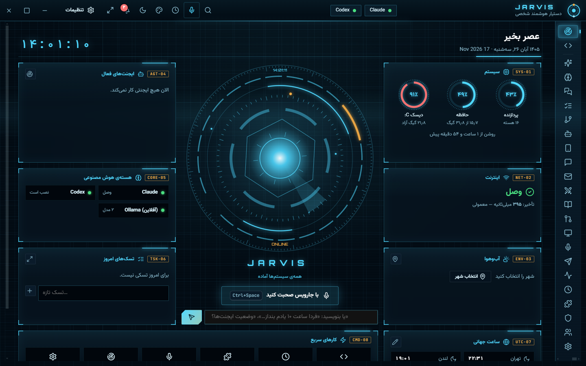

<p align="center">
<a href="https://github.com/borhanslm/jarvis-agents/releases/latest/download/JARVIS-Setup.exe"><b>⬇️ دانلود جارویس برای ویندوز</b></a>
&nbsp;·&nbsp;
<a href="https://github.com/borhanslm/jarvis-agents/releases">همه‌ی نسخه‌ها</a>
</p>

---

## فهرست

1. [تازه‌های جارویس ۲](#تازه‌های-جارویس-۲)
2. [قبل از نصب چه لازم دارید؟](#قبل-از-نصب-چه-لازم-دارید)
3. [نصب، قدم به قدم](#نصب-قدم-به-قدم)
4. [اولین بار: وصل کردن حساب‌ها](#اولین-بار-وصل-کردن-حساب‌ها)
5. [اولین کار با تیم کدنویسی](#اولین-کار-با-جارویس)
6. [حالت‌های کار](#حالت‌های-کار)
7. [حالت هوشمند](#حالت-هوشمند)
8. [اتصال‌دهنده‌ها (MCP)](#اتصال‌دهنده‌ها-mcp)
9. [پلاگین‌ها](#پلاگین‌ها)
10. [صف کارها](#صف-کارها)
11. [اتاق عملیات سه‌بعدی](#اتاق-عملیات-سه‌بعدی)
12. [۱۲ ظاهر](#۱۲-ظاهر)
13. [امکانات دیگر](#امکانات-دیگر)
14. [ترفندهای کاربردی](#ترفندهای-کاربردی)
15. [به‌روزرسانی](#به‌روزرسانی)
16. [اگر به مشکل خوردید](#اگر-به-مشکل-خوردید)

---

## تازه‌های جارویس ۲

### مرکز فرمان
وضعیت همه‌چیز در یک صفحه: کره‌ی هوش مصنوعی، CPU و حافظه، ایجنت‌های فعال، وضعیت مدل‌ها، تسک‌های امروز، ساعت چند شهر، آب‌وهوا و اینترنت. همه با داده‌ی واقعی.

### دستیار صوتی «هی جارویس»
بیدارباش کاملاً آفلاین است؛ تا «هی جارویس» نگویید هیچ صدایی ذخیره یا فرستاده نمی‌شود. جواب می‌دهد «بله؟» و گوش می‌کند. گفتار به متن و متن به گفتار هم محلی (رایگان و آفلاین) و هم با API، به فارسی و انگلیسی. می‌تواند تیم را راه بیندازد، تسک اضافه کند، برنامه باز کند، آهنگ پخش کند و گزارش بدهد. یادتان می‌ماند («یادت باشه…») و در حالت یادگیری خودش نکته‌ها را برمی‌دارد.

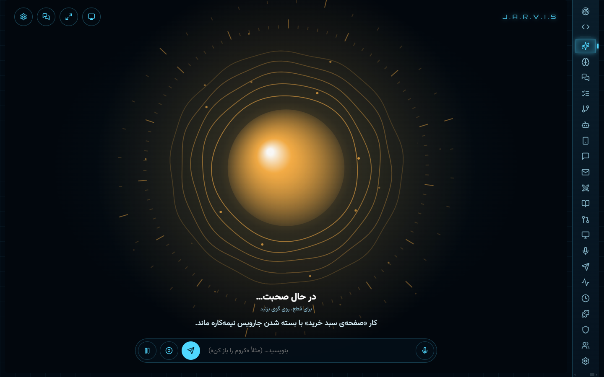

### هسته‌ی هوش مصنوعی و چت
همه‌ی مدل‌ها یک‌جا: حساب‌ها، کلیدهای API و مدل‌های محلی، با آزمایش اتصال و قیمت. چت عادی جدا از پروژه‌ها با هر مدل، پیوست عکس، جستجو و خروجی. در هر گفتگو می‌توانید **اجازه‌ی کنترل کامپیوتر** بدهید.

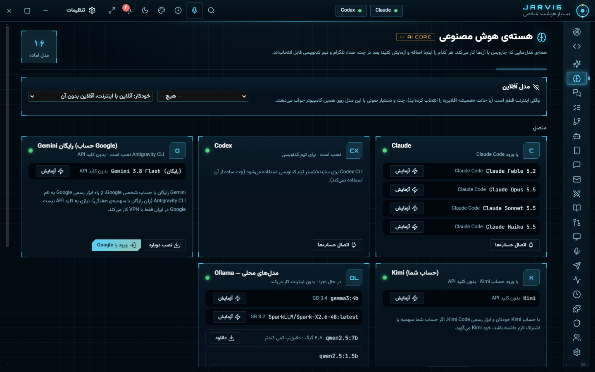

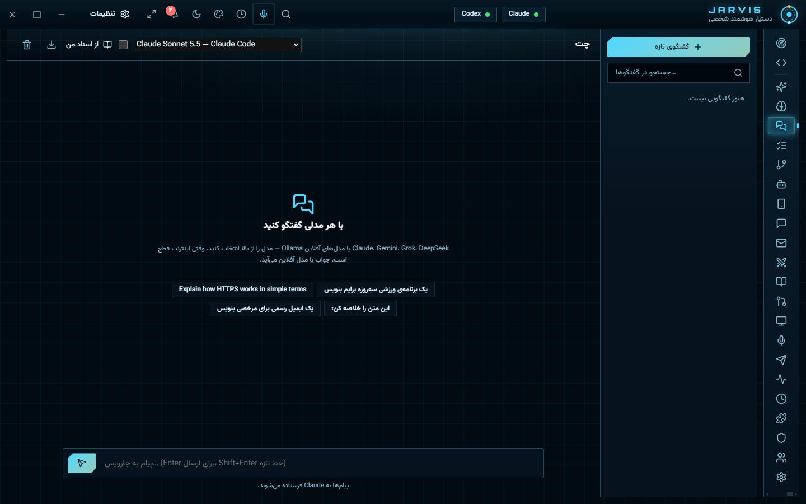

### کنترل کامپیوتر
«تو اسپاتیفای فلان آهنگ را پخش کن» یا هر کار دیگری در هر برنامه‌ی ویندوز. ایجنت کامپیوتر صفحه را می‌بیند، کلیک و تایپ می‌کند تا کار تمام شود. اگر موس را تکان دهید کنار می‌کشد. کارهای برگشت‌ناپذیر (ارسال، پرداخت، حذف) قبلش تأیید می‌خواهند و رمز و شماره‌ی کارت هرگز تایپ نمی‌شود.

### تسک‌ها و ورک‌فلوها
تسک‌های کار و زندگی با یادآور و اولویت؛ تسک‌های برنامه‌نویسی خودشان به تیم می‌روند. ورک‌فلوساز گرافیکی با کشیدن و رها کردن، یا ساخت ورک‌فلو از یک توصیف.

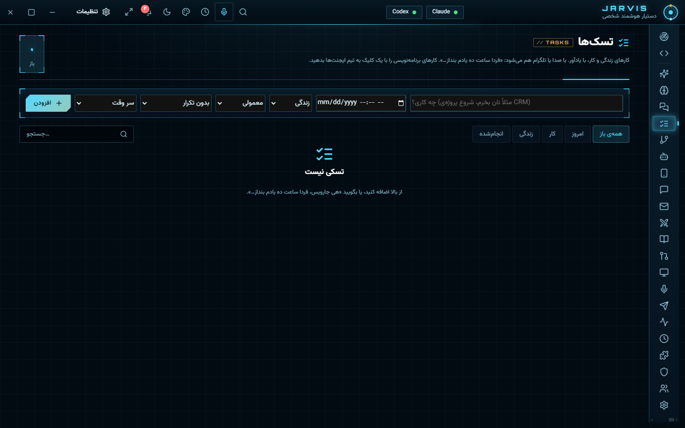

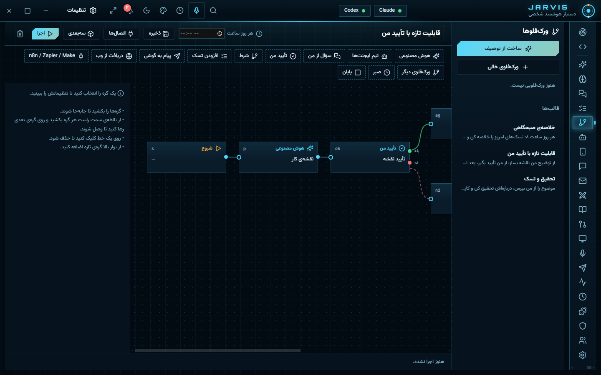

### ایجنت‌ها و اسکیل‌ها
ایجنت‌های متخصص روی هر مدل، با قالب، تست، نسخه و import/export. هر مدلی می‌تواند سازنده، تستر یا ساب‌ایجنت باشد. اسکیل‌ها را با هوش مصنوعی بسازید، آپلود کنید، یا با **صدا** و **ویدیو** به جارویس یاد بدهید. پلاگین، اسکیل و MCP را از اینترنت جستجو و بعد از بررسی نصب کنید.

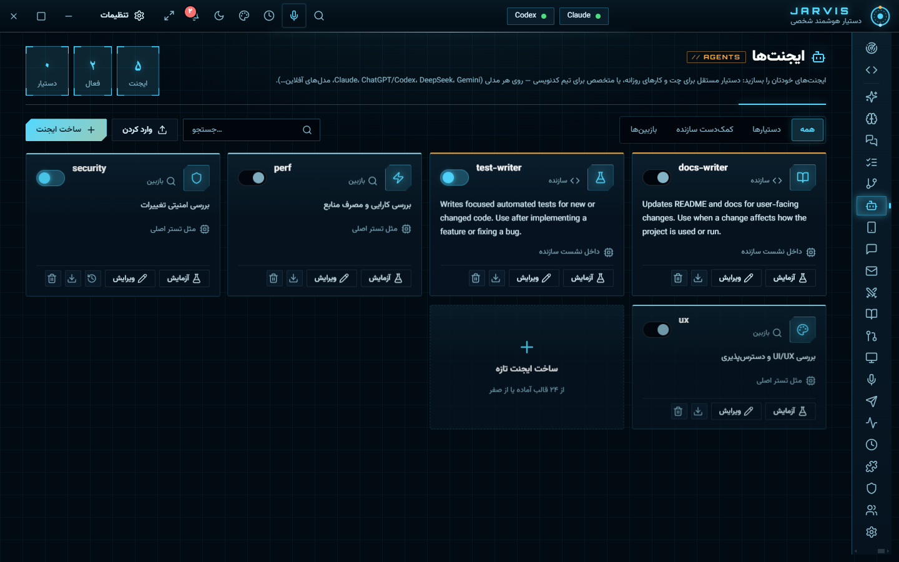

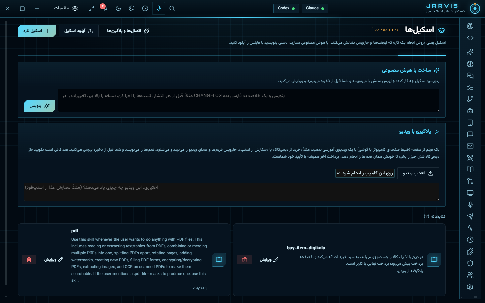

### ایمیل و تقویم
صندوق ایمیل (IMAP/SMTP) با خلاصه و پیش‌نویس جواب؛ ارسال **فقط با تأیید شما**. تقویم‌های iCal با رویدادهای تکراری.

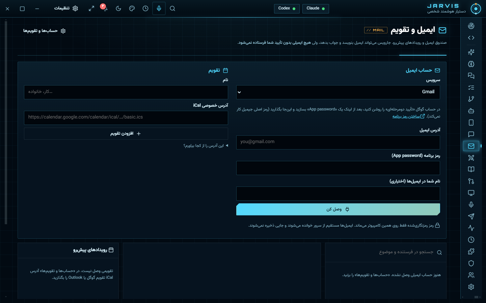

### گوشی و تلگرام
اپ اندروید جارویس با QR جفت می‌شود: پیامک، اعلان، تماس و تأیید کارها روی گوشی. ربات تلگرام یا بله هم پیام متنی و صوتی فارسی را جواب می‌دهد، فقط به خود شما.

**دانلود اپ اندروید:** [آخرین نسخه (APK)](https://github.com/borhanslm/jarvis-android-app/releases/latest/download/JARVIS-Android.apk) — دانلود رایگان است و استفاده لایسنس می‌خواهد. همین لینک و QR آن در صفحه‌ی «گوشی» جارویس هم هست.

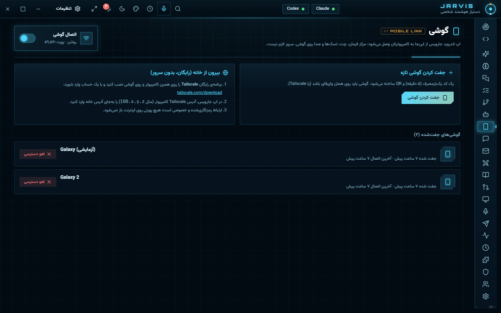

### میدان مدل‌ها و بحث چند ایجنت
یک سؤال را هم‌زمان به چند مدل بدهید و جواب، سرعت و هزینه را کنار هم ببینید، رأی بدهید و جدول امتیاز بسازید. یا بگذارید چند مدل چند دور بحث کنند و یک داور جمع‌بندی کند.

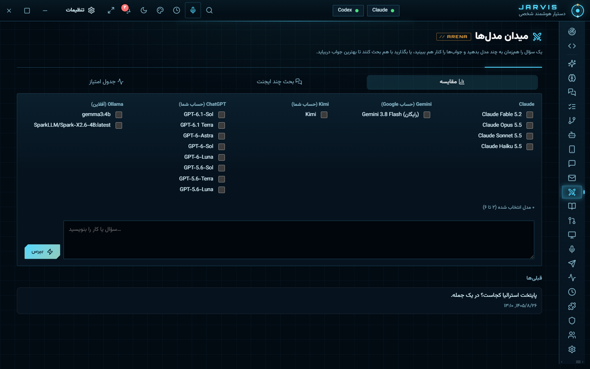

### پایگاه دانش اسناد
پوشه‌های اسنادتان (Word، PDF، متن، Markdown، CSV، HTML) روی همین کامپیوتر فهرست می‌شوند و جارویس از رویشان جواب می‌دهد، با نام فایل به‌عنوان منبع. در چت و صدا هم کار می‌کند.

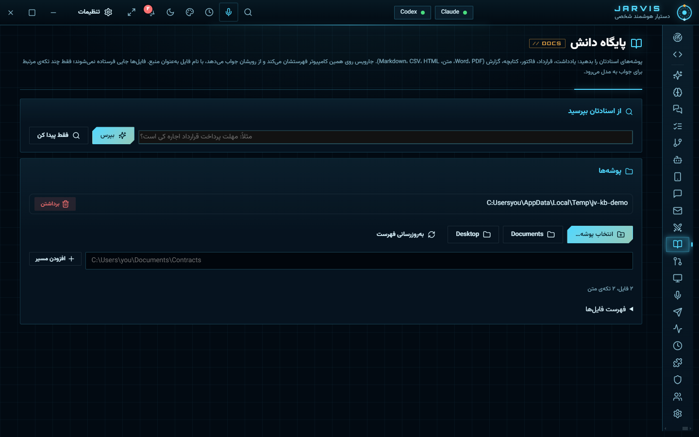

### بررسی PR، تست مرورگر و سندباکس
- **بررسی Pull Request:** PRهای باز مخزن GitHub پروژه را با هر مدلی بررسی کنید. ثبت در GitHub یا اصلاح با تیم فقط با تأیید شما.
- **تست مرورگر:** سایت در اندازه‌ی دسکتاپ و موبایل باز می‌شود و گزارش می‌گیرید: عکس صفحه‌ها، خطاهای کنسول، درخواست‌های ناموفق، بیرون‌زدگی صفحه و مشکلات دسترسی‌پذیری، با امتیاز، نظر هوش مصنوعی و خروجی HTML.
- **سندباکس:** تست‌های پروژه روی یک کپی جدا بدون کلیدهای شما، یا داخل Docker یا Windows Sandbox.

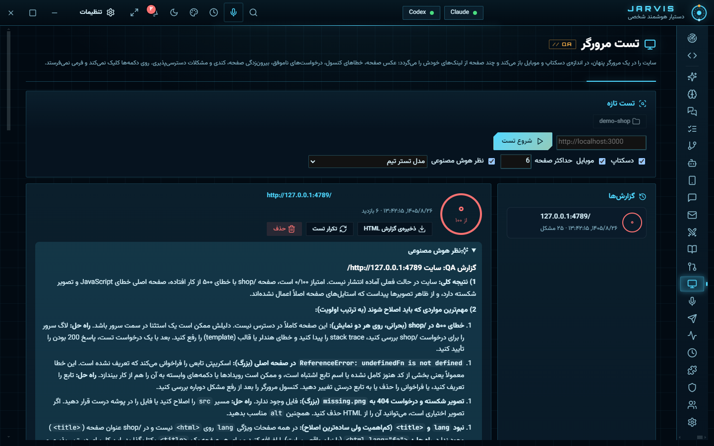

### مجوزها، گزارش و بودجه
هر کاری که جارویس می‌کند (صوتی، چت، تلگرام، گوشی) در **لاگ ممیزی** ثبت می‌شود، با خروجی CSV. هر دسته از کارها را می‌توانید خاموش کنید. برای هر پروژه و هر ساب‌ایجنت سقف هزینه‌ی ماهانه بگذارید. اگر جارویس وسط کار بسته شد، بعد از باز شدن ادامه می‌دهد.

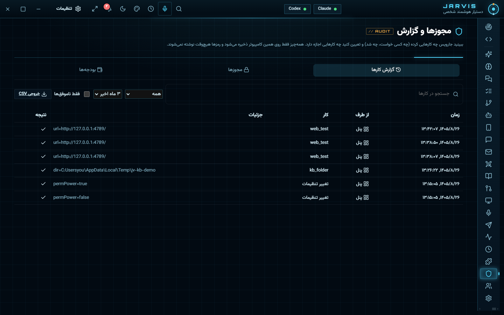

---

## قبل از نصب چه لازم دارید؟

| چه چیزی | چرا | از کجا |
|---|---|---|
| ویندوز ۱۰ یا ۱۱ (۶۴ بیتی) | جارویس برنامه‌ی ویندوز است | — |
| **کلید API از Anthropic** | برای مدل‌های Claude | [console.anthropic.com](https://console.anthropic.com/settings/keys) |
| **حساب ChatGPT** (یا کلید API از OpenAI) | برای Codex | [chatgpt.com](https://chatgpt.com) |
| Node.js | برای نصب Codex و بیشتر اتصال‌دهنده‌ها | [nodejs.org](https://nodejs.org) — نسخه‌ی LTS |
| Git (پیشنهادی) | برای نقطه‌ی بازگشت و دیدن تغییرات هر فایل | [git-scm.com](https://git-scm.com/downloads) |

> **لازم نیست** هم Claude داشته باشید و هم ChatGPT. با یکی از آن‌ها، یا فقط با یک API دیگر (مثلاً DeepSeek) هم کار می‌کند.
>
> Claude Code و Codex را هم لازم نیست جداگانه نصب کنید: خود جارویس در اولین اجرا نصبشان می‌کند.

---

## نصب، قدم به قدم

**۱. دانلود** — روی [دانلود جارویس برای ویندوز](https://github.com/borhanslm/jarvis-agents/releases/latest/download/JARVIS-Setup.exe) بزنید. فایل `JARVIS-Setup.exe` (حدود ۸۰ مگابایت) دانلود می‌شود.

**۲. اجرا** — روی فایل دانلودشده دوبار کلیک کنید.

**۳. هشدار ویندوز** — احتمالاً یک صفحه‌ی آبی با عنوان **«Windows protected your PC»** می‌بینید. این طبیعی است: برنامه امضای دیجیتال پولی ندارد، برای همین ویندوز آن را نمی‌شناسد.
   - روی **More info** بزنید.
   - بعد روی دکمه‌ی **Run anyway** بزنید.

**۴. نصب** — پنجره‌ی نصب باز می‌شود. تنظیمات پیش‌فرض خوب هستند: **Next** ← **Install** ← **Finish**.

**۵. تمام** — جارویس باز می‌شود. از این به بعد آیکونش روی دسکتاپ و در منوی Start هست.

---

## اولین بار: وصل کردن حساب‌ها

بار اول خودبه‌خود پنجره‌ی **«اتصال‌ها»** باز می‌شود. بعداً هم از زبانه‌ی **تیم** ← **اتصال حساب‌ها** در دسترس است. هر کارت باید سبز و **«متصل»** شود.

### Claude
1. اگر نوشته «Claude CLI نصب نیست»، روی **نصب Claude CLI** بزنید. یک پنجره‌ی سیاه باز می‌شود و نصب می‌کند. وقتی تمام شد آن را ببندید و **بررسی دوباره** را بزنید.
2. روی **گرفتن کلید از Anthropic Console** بزنید. در سایت وارد شوید، **Create Key** را بزنید و کلیدی را که با `sk-ant-` شروع می‌شود کپی کنید.
3. کلید را در کادر جارویس بچسبانید و **ذخیره‌ی کلید** را بزنید.

### Codex (ChatGPT)
1. اگر نوشته «برای نصب Codex اول Node.js لازم است»، روی **دانلود Node.js** بزنید، آن را نصب کنید و جارویس را یک بار ببندید و باز کنید.
2. روی **نصب Codex CLI** بزنید. وقتی پنجره‌ی نصب تمام شد، **بررسی دوباره** را بزنید.
3. روی **ورود با حساب ChatGPT** بزنید. مرورگر باز می‌شود؛ وارد حساب ChatGPT شوید و اجازه بدهید. به‌جای آن می‌توانید کلید API از OpenAI را ذخیره کنید.

> کلیدها رمزنگاری‌شده و فقط روی همین کامپیوتر ذخیره می‌شوند.

### DeepSeek و APIهای دیگر

در پنجره‌ی **اتصال‌ها**، بخش **اتصال‌های دیگر**، روی **افزودن اتصال** بزنید:

1. **سرویس** را انتخاب کنید: DeepSeek، Kimi، GLM، MiniMax، OpenAI یا سفارشی. آدرسش خودش پر می‌شود.
2. **کلید API** همان سرویس را بچسبانید. لینک «گرفتن کلید» کنارش است.
3. **دریافت فهرست مدل‌ها** و بعد **آزمایش اتصال** را بزنید. باید بنویسد «اتصال برقرار است».
4. اگر بخواهید، **قیمت** هر یک میلیون توکن را وارد کنید تا هزینه‌اش حساب شود.
5. **آزمایش کامل** یک کار واقعی کوچک را یک بار به‌عنوان سازنده و یک بار به‌عنوان تستر اجرا می‌کند.
6. **ذخیره** را بزنید.

حالا در **تنظیمات ← مدل‌ها** یا پایین کادر پیام، آن را برای **سازنده** یا **تستر** انتخاب کنید. هر ترکیبی کار می‌کند؛ مثلاً DeepSeek بسازد و Codex تست کند.

> کلید هر اتصال فقط به همان سرویس فرستاده می‌شود و هر اتصال پروفایل جدای خودش را دارد. ورود Claude و ChatGPT شما هرگز به آن سرویس‌ها داده نمی‌شود.

---

## اولین کار با جارویس

بخش **«تیم کدنویسی»** (آیکون `</>` در نوار کناری):

**۱. یک پروژه اضافه کنید** — در نوار کناری، کنار «پروژه‌ها»، روی آیکون پوشه با علامت **+** بزنید و مسیر پوشه‌ی پروژه را بنویسید (مثلاً `C:\Projects\my-site`). آیکون ذره‌بین پروژه‌هایی را که قبلاً با Claude Code یا Codex باز کرده‌اید خودش پیدا می‌کند.

**۲. فرمان بدهید** — در صفحه‌ی اصلی، در کادر وسط بنویسید چه می‌خواهید؛ مثلاً:
> یک صفحه‌ی ورود با بازیابی رمز عبور بساز

و **شروع** را بزنید.

**۳. تماشا کنید** — سازنده می‌نویسد، جارویس تست‌های خود پروژه را اجرا می‌کند، تستر بررسی می‌کند و اگر باگی بود سازنده رفع می‌کند. در پایان یک **گزارش** می‌آید: چه فایل‌هایی عوض شد، چند دور طول کشید، هزینه چقدر شد و آیا تأیید شد.


> هر کار قبل از شروع یک **نقطه‌ی بازگشت** می‌سازد (اگر پروژه Git باشد). اگر نتیجه را نخواستید، روی «بازگشت به این نقطه» بزنید.

---

## حالت‌های کار

بالای کادر پیام، حالت را انتخاب کنید:

| حالت | چه می‌کند | کی به درد می‌خورد |
|---|---|---|
| **تیمی** | سازنده می‌نویسد ← تستر تست می‌کند ← سازنده رفع می‌کند | بیشتر وقت‌ها |
| **هوشمند** | جارویس کار را تقسیم می‌کند و هر بخش را با مدل مناسبش انجام می‌دهد؛ بعد تستر کل کار را بررسی می‌کند | کارهای بزرگ، وقتی می‌خواهید ارزان‌تر تمام شود |
| **بازرسی و رفع** | اول تستر کل پروژه را بررسی می‌کند، بعد سازنده باگ‌ها را رفع می‌کند | پروژه‌ی موجودی که مشکل دارد |
| **طراحی** | سازنده طرح می‌دهد، تستر نقد می‌کند، طرح نهایی (بدون تغییر کد) | قبل از یک کار بزرگ |
| **فقط سازنده** | بدون بررسی | سؤال یا کار سریع |
| **فقط تستر** | فقط خواندنی | نظر دوم دربارهٔ کد |

پایین کادر پیام:
- **ترکیب تیم**: ترکیب‌های آماده، مثلاً «قوی»، «متعادل»، «اقتصادی» یا «DeepSeek برای هر دو نقش». ترکیب خودتان را هم می‌توانید ذخیره کنید.
- **مدل و میزان فکر** سازنده و تستر، برای همین گفتگو.
- **برآورد هزینه**ی کار بعدی، بر اساس کارهای قبلی.

---

## حالت هوشمند

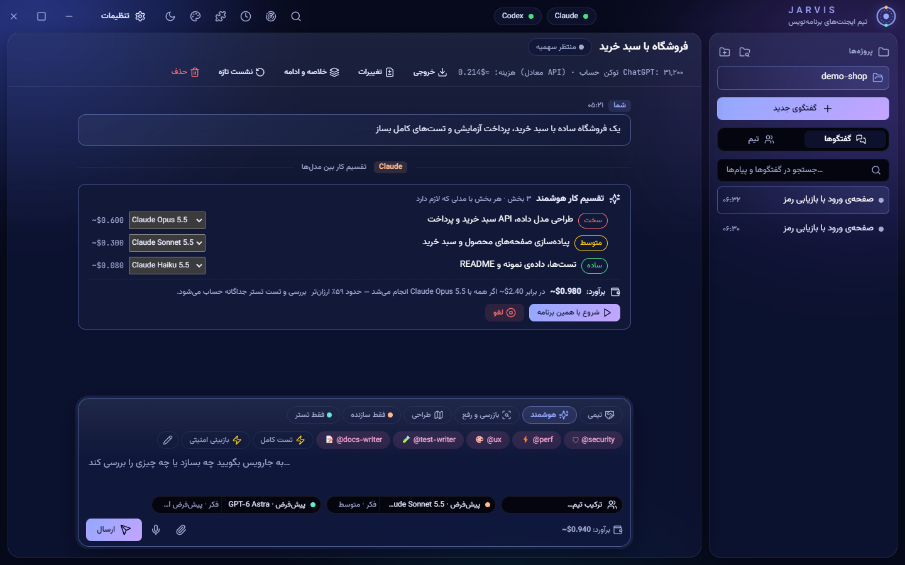

1. یک مدل ارزان و سریع (پیش‌فرض: Claude Haiku 5.5) پیام شما را می‌خواند و کار را به ۱ تا ۶ بخش تقسیم می‌کند. هر بخش یک سطح دارد: **سخت**، **متوسط** یا **ساده**.
2. هر سطح با مدل خودش انجام می‌شود. پیش‌فرض: سخت ← Claude Opus 5.5، متوسط ← Claude Sonnet 5.5، ساده ← Claude Haiku 5.5.
3. یک کارت، برنامه و هزینه‌ی تخمینی را نشان می‌دهد و آن را با هزینه‌ی «همه با قوی‌ترین مدل» مقایسه می‌کند.
4. هر بخش خلاصه‌ی کار بخش‌های قبلی را می‌گیرد تا چیزی گم نشود.
5. در آخر تستر کل کار را بررسی می‌کند و باگ‌ها با مدل «متوسط» رفع می‌شوند.

در **تنظیمات ← حالت هوشمند** می‌توانید هر سطح را به هر مدل یا اتصالی (مثلاً DeepSeek) بدهید. اگر «اجرای خودکار» را خاموش کنید، قبل از شروع می‌توانید مدل هر بخش را عوض کنید.

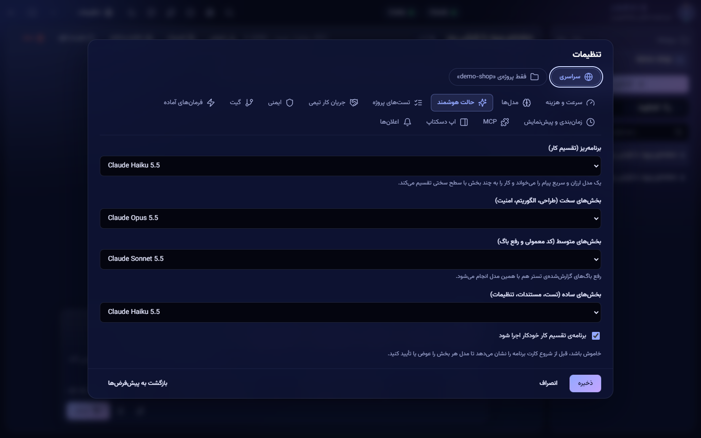

> برای یک تغییر کوچک، برنامه‌ریز فقط یک بخش می‌سازد؛ پس حالت هوشمند گران‌تر از تیمی نمی‌شود.

---

## اتصال‌دهنده‌ها (MCP)

دکمه‌ی 🧩 بالای صفحه ← زبانه‌ی **اتصال‌دهنده‌ها**.

اتصال‌دهنده‌ها همان سرورهای MCP هستند که Claude Code هم استفاده می‌کند: ابزارهای اضافه برای ایجنت‌ها. چند نمونه‌ی آماده هست:

| اتصال‌دهنده | چه می‌کند |
|---|---|
| **Playwright** | مرورگر واقعی: باز کردن صفحه، کلیک، اسکرین‌شات — عالی برای تستر وب |
| **Context7** | مستندات به‌روز کتابخانه‌ها، برای نوشتن کد درست |
| **GitHub** | Issueها، Pull Requestها و کد مخزن‌ها |
| **PostgreSQL** | خواندن ساختار و داده‌ی پایگاه‌داده |
| **Memory** | حافظه‌ی ماندگار بین اجراها |
| **Sequential Thinking** | فکر کردن مرحله‌به‌مرحله برای مسئله‌های سخت |
| **Brave Search** | جستجوی وب |

با **اتصال‌دهنده‌ی دلخواه** هر سرور MCP دیگری را هم اضافه کنید: یک فرمان (مثل `npx …`) یا یک آدرس https.

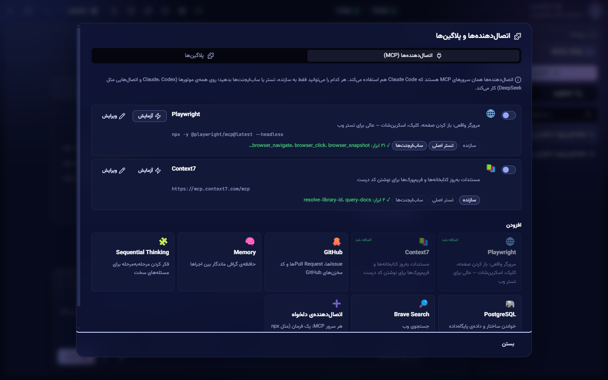

- برای هر کدام انتخاب کنید به **سازنده**، **تستر اصلی** یا **ساب‌ایجنت‌ها** داده شود.
- روی همه‌ی موتورها کار می‌کند: Claude، Codex و اتصال‌هایی مثل DeepSeek.
- دکمه‌ی **آزمایش** سرور را اجرا می‌کند و فهرست ابزارهایش را نشان می‌دهد.
- کلیدها و توکن‌ها رمزنگاری‌شده و فقط روی همین کامپیوتر ذخیره می‌شوند.

---

## پلاگین‌ها

دکمه‌ی 🧩 بالای صفحه ← زبانه‌ی **پلاگین‌ها**.

پلاگین‌ها با همان قالب پلاگین‌های Claude Code هستند و از سه جا نصب می‌شوند:
- یک مخزن GitHub یا یک مارکت‌پلیس، مثلاً `anthropics/claude-plugins-official` (بیش از ۳۰۰ پلاگین) یا `anthropics/claude-code`
- پلاگین‌هایی که در خود Claude Code نصب کرده‌اید
- یک پوشه

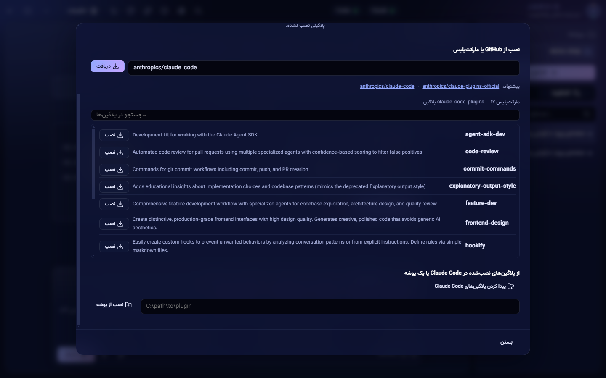

بعد از نصب:
- **ایجنت‌های** پلاگین به تیم اضافه می‌شوند: بررسی‌کننده‌ها کنار تستر، بقیه کمک سازنده.
- **اسکیل‌ها** به ایجنت‌ها وصل می‌شوند. اگر پلاگین ایجنت نداشته باشد، اسکیل‌ها به خود سازنده داده می‌شوند.
- **فرمان‌ها** بالای کادر پیام می‌آیند.
- **سرورهای MCP** پلاگین به اتصال‌دهنده‌ها اضافه می‌شوند، ولی **خاموش**. اول فرمانشان را ببینید و اگر اعتماد دارید روشنشان کنید.

---

## صف کارها

دکمه‌ی 🕒 بالای صفحه.

چند کار، حتی برای پروژه‌های مختلف، بچینید تا یکی‌یکی اجرا شوند؛ همین حالا یا از ساعتی که تعیین می‌کنید، مثلاً شب. اگر **اعلان روی گوشی** روشن باشد، آخر کار خلاصه‌ی نتیجه به بله یا تلگرام شما می‌آید.

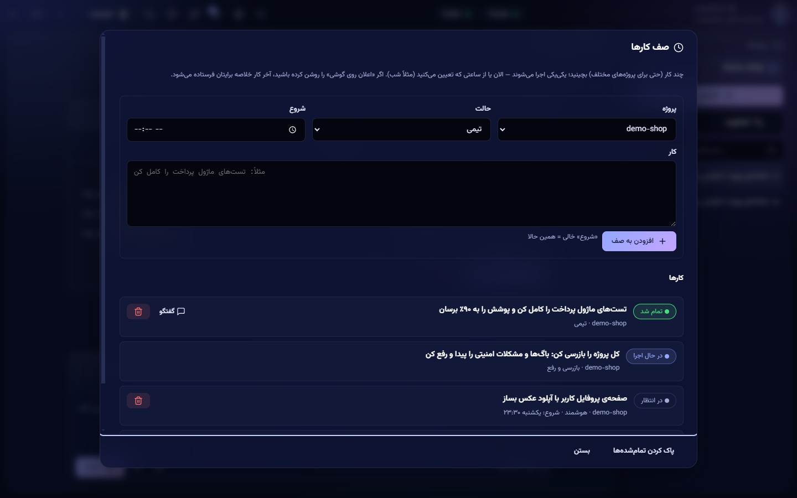

---

## اتاق عملیات سه‌بعدی

دکمه‌ی 📡 بالای صفحه.

نمای سه‌بعدی و زنده‌ی همه‌ی ایجنت‌هایی که الان کار می‌کنند، دور واکنشگر مرکزی جارویس:
- بالای هر ایجنت نوشته می‌شود الان چه می‌کند، مثلاً «در حال نوشتن src/cart.js» یا «اجرای npm test».
- رنگ‌ها: نارنجی سازنده، فیروزه‌ای تستر، سبز ساب‌ایجنت‌ها.
- وقتی کار از یک ایجنت به ایجنت دیگر می‌رسد، پرتویی بینشان رد می‌شود. ویرایش هر فایل جرقه می‌زند.
- با کلیک روی هر ایجنت، گزارش زنده‌اش باز می‌شود. با موس صحنه را بچرخانید و زوم کنید.

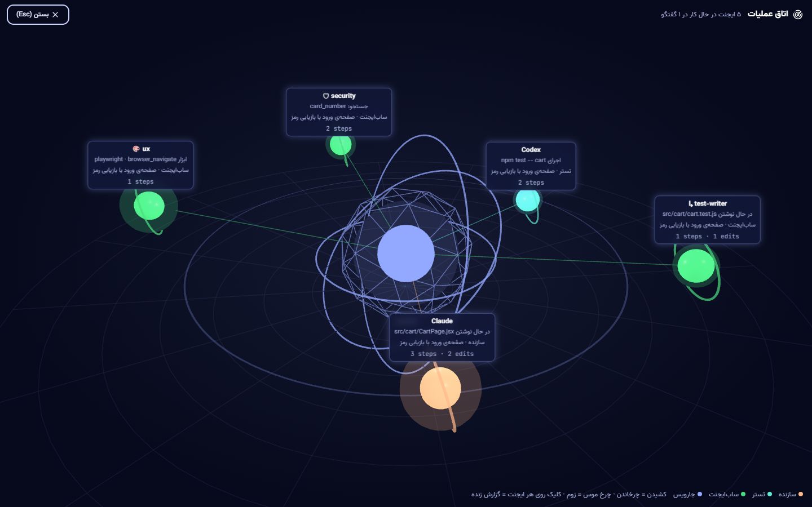

---

## ۱۲ ظاهر

دکمه‌ی 🎨 بالای صفحه. هر ظاهر نسخه‌ی تیره و روشن دارد. کنار آن، دکمه‌ی 🌙 تیره، روشن یا هماهنگ با ویندوز را انتخاب می‌کند.


<table>
<tr><th>ظاهر</th><th>تیره</th><th>روشن</th></tr>
<tr><td><b>هولوگرام</b><br><code>holo</code></td><td>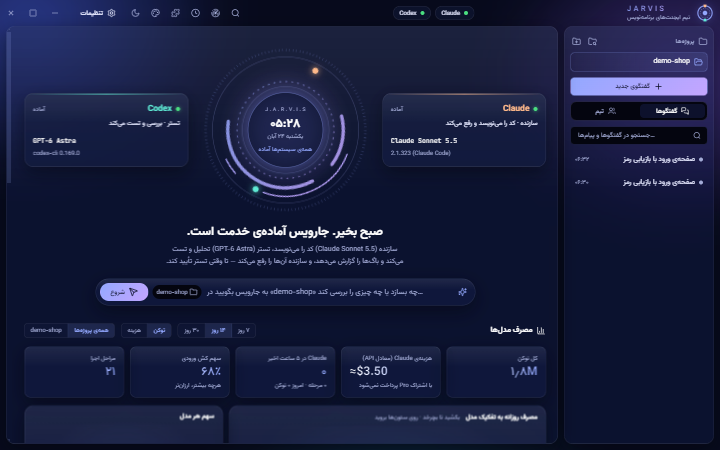</td><td>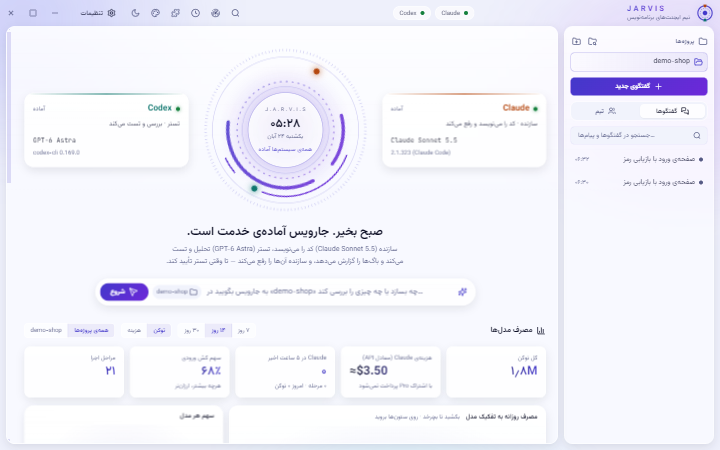</td></tr>
<tr><td><b>نیمه‌شب</b><br><code>midnight</code></td><td>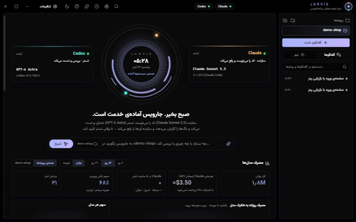</td><td>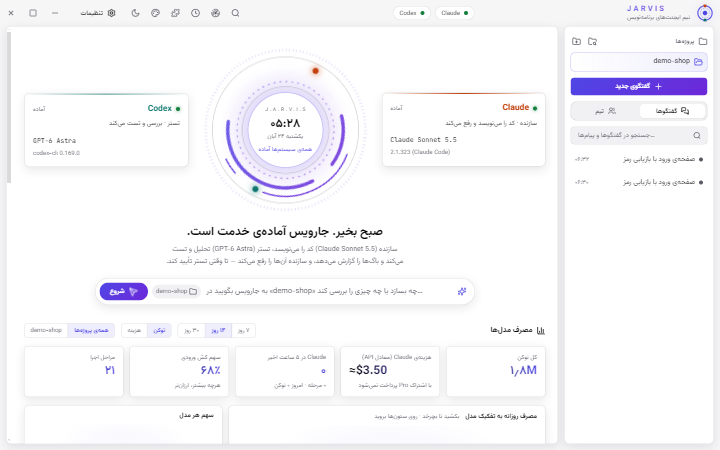</td></tr>
<tr><td><b>زره</b><br><code>armor</code></td><td>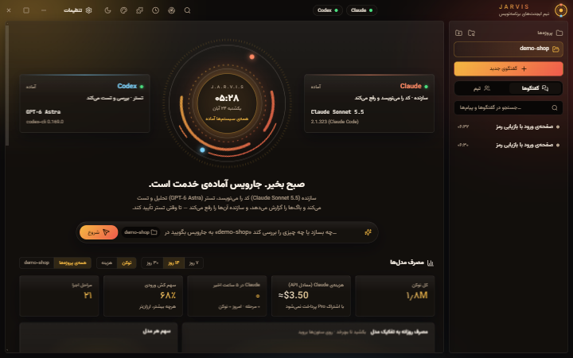</td><td></td></tr>
<tr><td><b>راکتور</b><br><code>arc</code></td><td>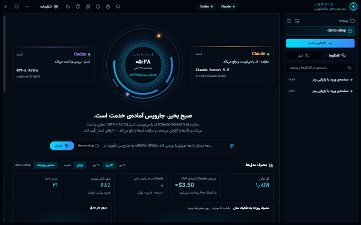</td><td>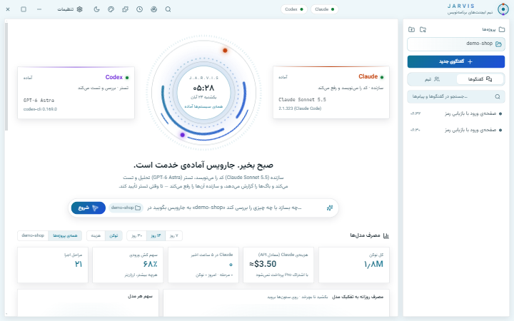</td></tr>
<tr><td><b>جنگل</b><br><code>forest</code></td><td>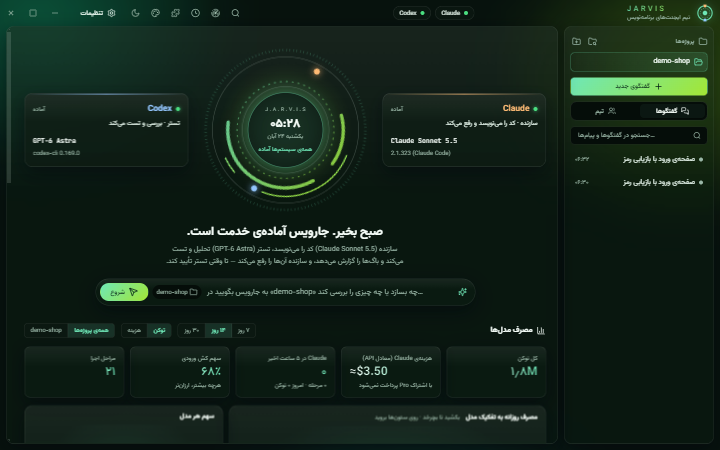</td><td>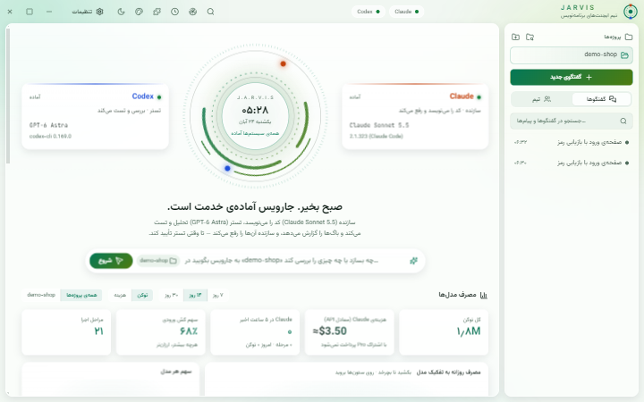</td></tr>
<tr><td><b>اقیانوس</b><br><code>ocean</code></td><td>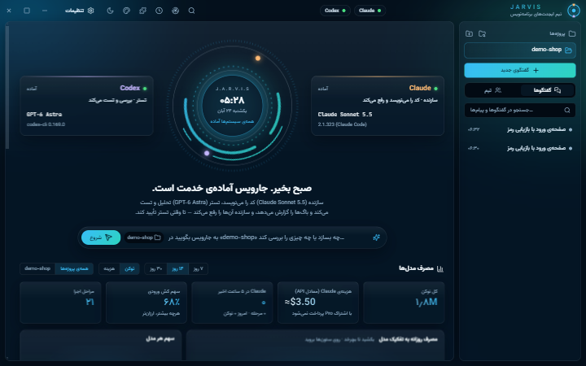</td><td>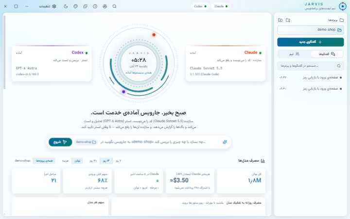</td></tr>
<tr><td><b>غروب</b><br><code>sunset</code></td><td>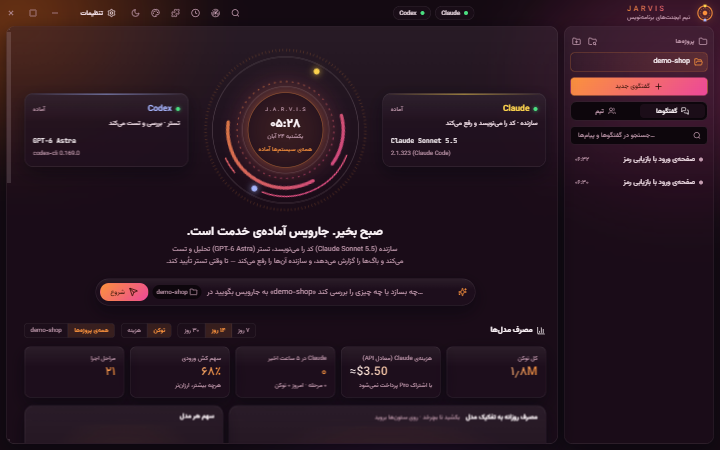</td><td>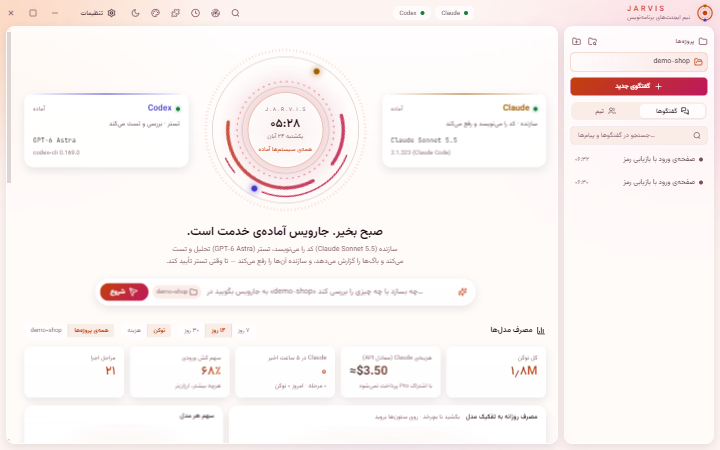</td></tr>
<tr><td><b>گل‌سرخ</b><br><code>rose</code></td><td>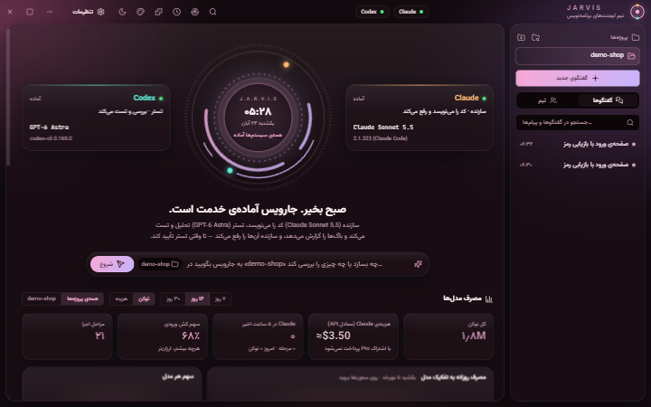</td><td>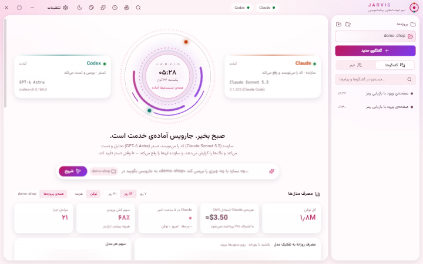</td></tr>
<tr><td><b>کاغذ</b><br><code>paper</code></td><td>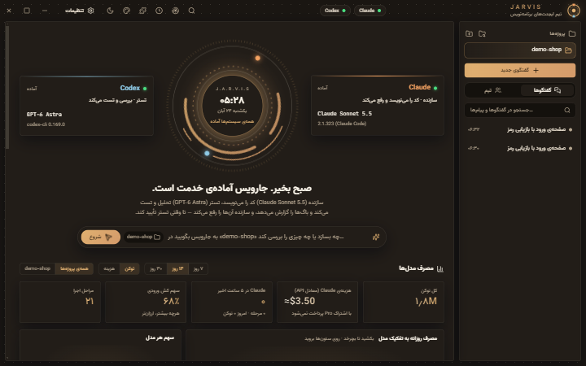</td><td>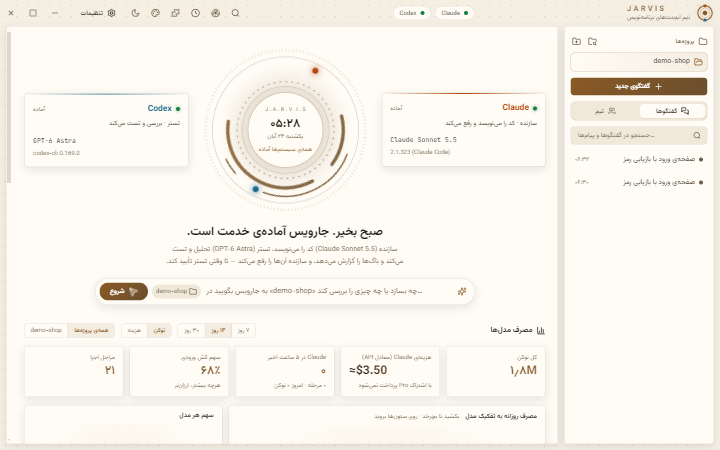</td></tr>
<tr><td><b>شمال</b><br><code>nord</code></td><td>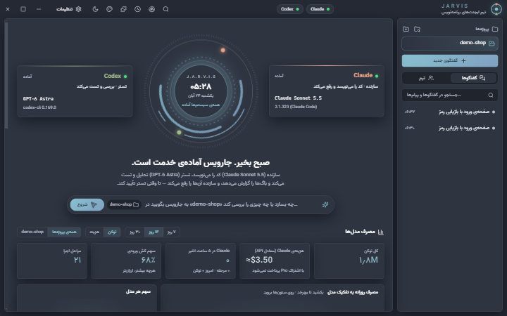</td><td>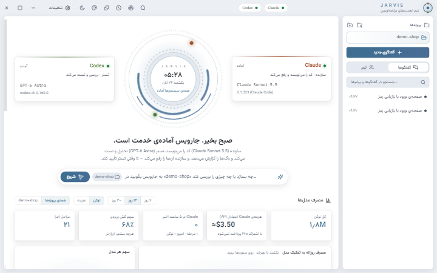</td></tr>
<tr><td><b>سایبرپانک</b><br><code>cyber</code></td><td>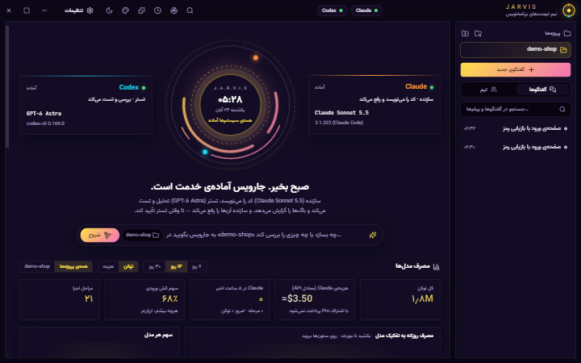</td><td>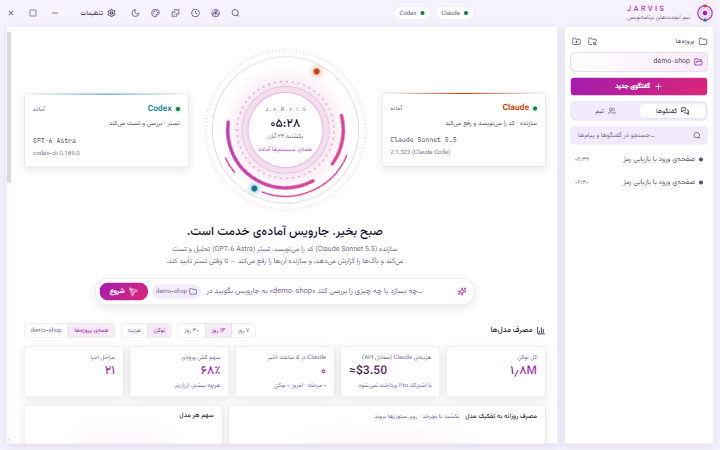</td></tr>
<tr><td><b>تک‌رنگ</b><br><code>mono</code></td><td>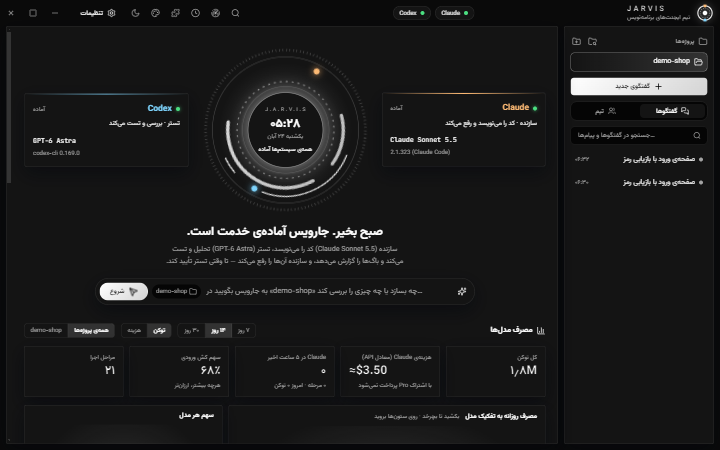</td><td>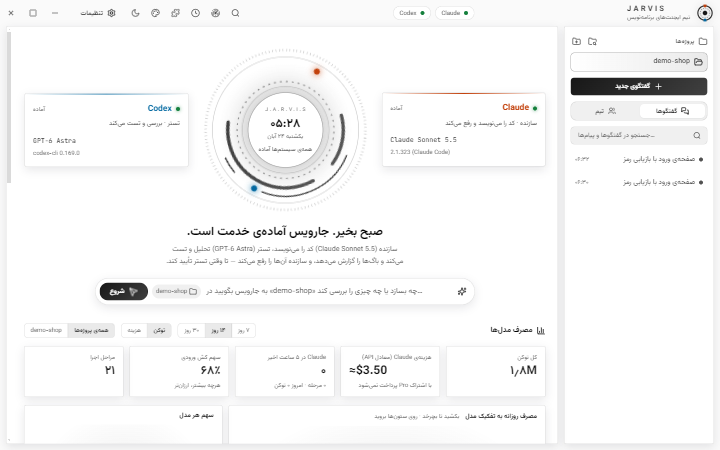</td></tr>
</table>

---

## امکانات دیگر

- **تست‌های خود پروژه** — جارویس بعد از هر دور، تست‌های پروژه را خودش اجرا می‌کند (npm test، pytest، go test و …). تا تست‌ها پاس نشوند، کار تأیید نمی‌شود.
- **ساب‌ایجنت‌ها** — متخصص‌هایی مثل امنیت، کارایی، UI/UX، نوشتن تست و مستندات، که کنار تستر یا کمک سازنده کار می‌کنند. با `@نام` در پیام مستقیم صدایشان کنید. هر کدام اسکیل و مدل خودش را می‌تواند داشته باشد.
- **جایگزین خودکار** — اگر سازنده یا تستر خطا داد، همان مرحله یک بار با مدل جایگزین تکرار می‌شود.
- **سهمیه‌ی اشتراک** — اگر سهمیه‌ی Claude پر شد، جارویس صبر می‌کند و بعد از تمدید خودش ادامه می‌دهد، یا Codex موقتاً جای سازنده کد می‌نویسد.
- **خلاصه و ادامه** — گفتگوهای خیلی طولانی را خلاصه کنید و با نشست تازه ادامه دهید تا ارزان‌تر شود.
- **حافظه‌ی پروژه** — جارویس قانون‌هایی را که از کار یاد گرفته پیشنهاد می‌دهد. با یک کلیک به `CLAUDE.md` و `AGENTS.md` اضافه می‌شوند.
- **اعلان روی گوشی** — پایان هر کار در بله یا تلگرام خبر داده می‌شود.
- **تغییرات فایل به فایل** — ببینید هر فایل چطور عوض شد و هر کدام را جدا برگردانید. commit و Pull Request هم از خود جارویس.
- **پیش‌نمایش** — پروژه‌ی وب را اجرا کنید و همان‌جا ببینید.
- **بازرسی زمان‌بندی‌شده** — هر روز در ساعتی که تعیین می‌کنید، پروژه خودکار بازرسی شود.
- **نمودار مصرف** — توکن‌ها و هزینه‌ی هر مدل در صفحه‌ی اصلی، به تفکیک Claude، ChatGPT و اتصال‌های دیگر.
- **پشتیبان‌گیری**، **عیب‌یابی** و **به‌روزرسانی CLIها** از زبانه‌ی **تیم**.

---

## ترفندهای کاربردی

- **تصویر بفرستید** — اسکرین‌شات را با `Ctrl+V` در کادر پیام بچسبانید یا بکشید داخلش؛ ایجنت آن را می‌بیند.
- **جستجو و فرمان سریع** — `Ctrl+K` را بزنید و هر پروژه، گفتگو یا فرمانی را پیدا کنید.
- **فرمان‌های آماده** — دستورهایی که زیاد تکرار می‌کنید را ذخیره کنید (دکمه‌ی مداد بالای کادر پیام). فرمان‌های پلاگین‌ها هم همان‌جا می‌آیند.
- **فرمان‌های قبلی** — در کادر پیام کلید `↑` را بزنید.
- **پیام وسط کار** — وقتی تیم در حال کار است هم پیام بفرستید؛ در مرحله‌ی بعد به سازنده می‌رسد.
- **کار در پس‌زمینه** — اگر پنجره را ببندید، جارویس کنار ساعت ویندوز می‌ماند و کار ادامه پیدا می‌کند. خروج کامل: راست‌کلیک روی آیکون کنار ساعت ← **خروج کامل**.
- **میانبر** — `Ctrl+Shift+J` از هر جای ویندوز جارویس را باز می‌کند.

---

## به‌روزرسانی

کاری لازم نیست. جارویس هر چند ساعت نسخه‌ی تازه را بررسی و در پس‌زمینه دانلود می‌کند. وقتی آماده شد، پایین صفحه نوار **«نسخه‌ی تازه آماده‌ی نصب است»** می‌آید. **نصب و راه‌اندازی دوباره** را بزنید، یا بگذارید با بستن کامل برنامه خودش نصب شود.

بررسی دستی: زبانه‌ی **تیم** ← **عیب‌یابی** ← **بررسی به‌روزرسانی**.

---

## اگر به مشکل خوردید

<details>
<summary><b>ویندوز اجازه‌ی نصب نمی‌دهد</b></summary>

در صفحه‌ی آبی «Windows protected your PC» اول **More info** و بعد **Run anyway** را بزنید. اگر آنتی‌ویروس فایل را پاک کرد، آن را در فهرست مجاز آنتی‌ویروس بگذارید.
</details>

<details>
<summary><b>Claude وصل نمی‌شود</b></summary>

- کلید باید با `sk-ant-` شروع شود و حساب Console شما اعتبار (credit) داشته باشد.
- **بررسی دوباره** را بزنید. اگر نشد، زبانه‌ی **تیم** ← **عیب‌یابی** را باز کنید و ببینید Claude CLI پیدا شده یا نه.
</details>

<details>
<summary><b>Codex نصب نمی‌شود</b></summary>

Node.js را از [nodejs.org](https://nodejs.org) نصب کنید (نسخه‌ی LTS)، جارویس را کامل ببندید و دوباره باز کنید، بعد **نصب Codex CLI** را بزنید.
</details>

<details>
<summary><b>یک اتصال‌دهنده کار نمی‌کند</b></summary>

- دکمه‌ی **آزمایش** را بزنید؛ خطای دقیق را نشان می‌دهد.
- بیشتر اتصال‌دهنده‌ها با `npx` اجرا می‌شوند و Node.js لازم دارند. بار اول دانلودشان ممکن است یک دقیقه طول بکشد.
- اگر نوشته «مقدار لازم وارد نشده»، روی **ویرایش** بزنید و کلید یا توکنش را وارد کنید.
</details>

<details>
<summary><b>دکمه‌ی میکروفون کار نمی‌کند</b></summary>

تبدیل گفتار به متن در برنامه‌های دسکتاپ در دسترس نیست. به‌جای آن از ورودی صوتی خود ویندوز استفاده کنید: در کادر پیام کلیک کنید و `Win+H` را بزنید.
</details>

<details>
<summary><b>اطلاعات من کجا ذخیره می‌شود؟ چطور حذف کنم؟</b></summary>

- همه‌چیز روی همین کامپیوتر است: `%APPDATA%\JARVIS` (تنظیمات، گفتگوها، لاگ‌ها).
- حذف برنامه: **Settings** ویندوز ← **Apps** ← **JARVIS** ← **Uninstall**.
- پشتیبان‌گیری از گفتگوها و تنظیمات: زبانه‌ی **تیم** ← **پشتیبان**.
</details>

<details>
<summary><b>اشتراک Claude Pro/Max دارم؛ می‌توانم به‌جای کلید API از آن استفاده کنم؟</b></summary>

نسخه‌ی منتشرشده طبق سیاست Anthropic فقط با کلید API وصل می‌شود. برای **استفاده‌ی شخصی روی کامپیوتر خودتان**، اگر Claude Code را با اشتراکتان وارد کرده‌اید، یک بار این دستور را در PowerShell اجرا کنید و جارویس را دوباره باز کنید:

```powershell
setx JARVIS_ALLOW_CLAUDE_LOGIN 1
```
این تنظیم بعد از به‌روزرسانی‌ها هم باقی می‌ماند.
</details>

---

<details>
<summary><b>برای برنامه‌نویس‌ها: اجرا از سورس، ساخت و انتشار</b></summary>

اجرا بدون نصب (نیازمند Node 18+ و CLIهای `claude` و `codex`):

```bash
npm install
npm start
```
پنل در `http://localhost:4777` باز می‌شود. پنجره‌ی دسکتاپ: `npm run app`. تست‌ها: `npm test`.

ساخت نصب‌کننده: `npm run dist` (خروجی در `dist/`).

انتشار نسخه‌ی جدید: `npm run release` — شماره‌ی نسخه را بالا می‌برد و تگ را push می‌کند. GitHub Actions تست‌ها را اجرا می‌کند، نصب‌کننده را می‌سازد و در Releases منتشر می‌کند. نسخه‌های نصب‌شده خودشان به‌روز می‌شوند.

ساختار: `server.js` (سرور محلی)، `lib/orchestrator.js` (جریان تیم و حالت هوشمند)، `lib/connectors.js` (MCP)، `lib/plugins.js` (پلاگین‌ها)، `lib/queue.js` (صف کارها)، `public/` (پنل)، `public/ops3d.js` (اتاق عملیات).

طراحی: توکن‌ها در `design/tokens.json`، ۱۲ ظاهر در `design/skins.cjs`؛ جزئیات در [design/DESIGN.md](design/DESIGN.md).
</details>

</div>
